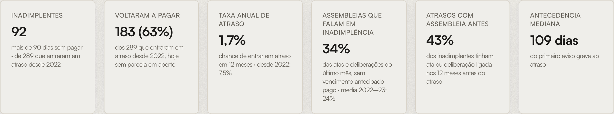
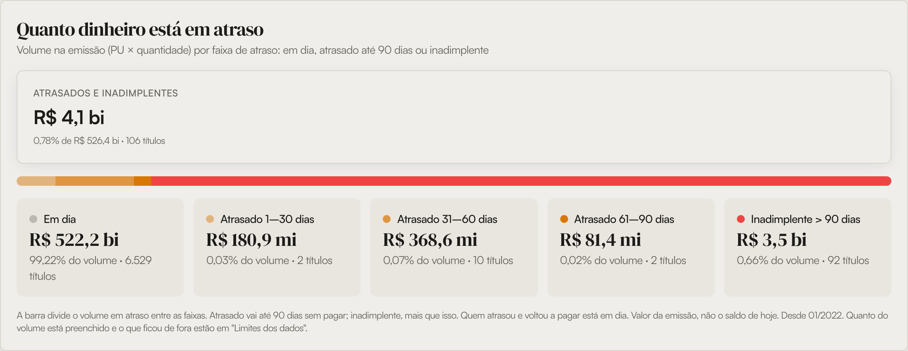
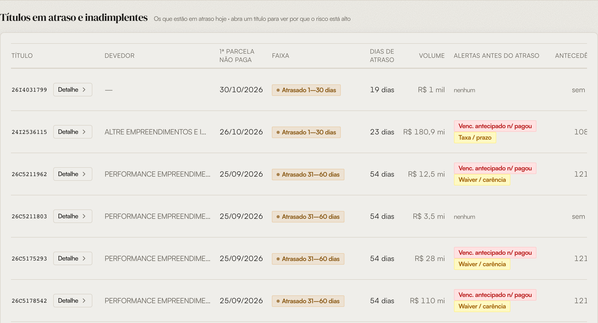
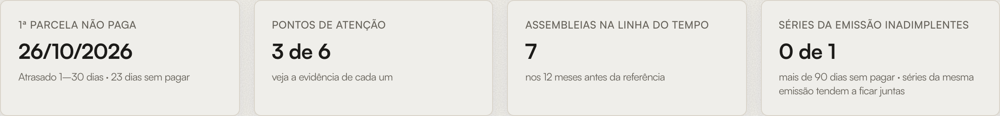
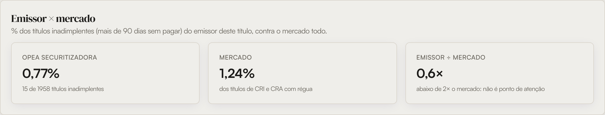
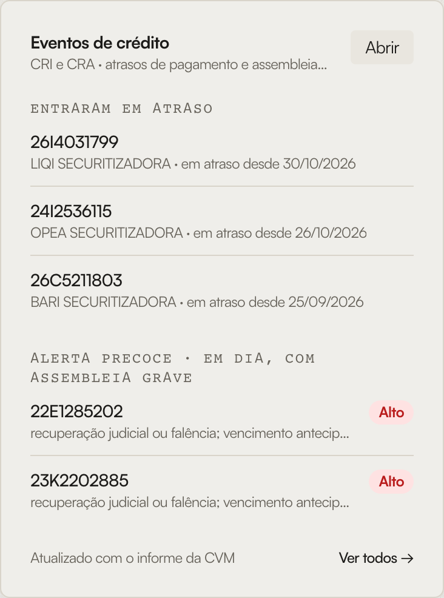

A tela **Risco de crédito** mostra quais CRI e CRA estão atrasados e há quanto tempo. Ela usa as mesmas palavras e as mesmas faixas em todas as telas: **Geral**, **Por fundo**, **Título › Crédito**, **Devedor** e **Hoje**.

<Info>
  **Onde fica:** em **Assets → Risco de crédito**. O título abre em **Assets → Títulos → Perfil**, aba **Crédito**. O devedor tem a aba **Crédito** própria. Os eventos do dia ficam em **Hoje**.
</Info>

<Note>
  A análise cobre só CRI e CRA. Debênture não entra.
</Note>

## Os termos

Três palavras têm um sentido fixo em toda a tela:

| Termo | O que significa |
|---|---|
| **Atrasado** | Título com 1 a 90 dias de atraso. |
| **Inadimplente** | Título com mais de 90 dias de atraso. |
| **Entrou em atraso** | O evento: o mês da primeira parcela não paga, mesmo que o título tenha voltado a pagar depois. |

"Atrasado" e "inadimplente" descrevem a **situação de hoje**. "Entrou em atraso" descreve **o que aconteceu** em algum mês desde 2022. Por isso os números de um e de outro são diferentes.

## As 5 faixas

Cada título cai em uma faixa:

| Faixa | O que significa |
|---|---|
| **Em dia** | Não tem parcela em aberto. Inclui quem atrasou e voltou a pagar. |
| **Atrasado 1–30 dias** | A primeira parcela não paga tem até 30 dias. |
| **Atrasado 31–60 dias** | De 31 a 60 dias. |
| **Atrasado 61–90 dias** | De 61 a 90 dias. |
| **Inadimplente > 90 dias** | Mais de 90 dias sem pagar. |

Nas telas, o atrasado aparece em laranja, mais forte a cada faixa, e o inadimplente em vermelho. A faixa sempre vem escrita, não só colorida.

### Como os dias são contados

Os dias contam **da primeira parcela não paga depois da última parcela paga, até hoje**. Três casos mostram a regra:

- **Voltou a pagar:** o título fica **em dia**, mesmo que tenha ficado muito tempo sem pagar antes.
- **Atrasou, voltou e atrasou de novo:** conta pelo atraso novo.
- **Vencimento antecipado pago:** quando o resgate total foi liquidado até a data da primeira parcela não paga, a dívida foi paga. O título fica fora de todas as faixas.

## Geral

Em **Risco de crédito → Geral**, de cima para baixo.

### Os indicadores do topo

<Frame caption="Os seis indicadores do topo da Geral">
  
</Frame>

| Indicador | O que mostra |
|---|---|
| **Inadimplentes** | Quantos títulos estão com mais de 90 dias sem pagar, entre os que entraram em atraso desde 2022. |
| **Voltaram a pagar** | Dos títulos que entraram em atraso desde 2022, quantos estão hoje sem parcela em aberto, e a porcentagem. |
| **Taxa anual de atraso** | A chance de um título entrar em atraso em 12 meses. O texto abaixo traz também a taxa acumulada desde 2022. |
| **Assembleias que falam em inadimplência** | Dos assuntos das atas e deliberações do último mês, a parte que fala em inadimplência. Fica de fora a assembleia de vencimento antecipado seguida de pagamento. O texto abaixo traz a média de 2022 a 2023. |
| **Atrasos com assembleia antes** | Dos títulos inadimplentes, quantos tinham ata ou deliberação ligada nos 12 meses antes do atraso. |
| **Antecedência mediana** | Quantos dias passaram, em geral, do primeiro aviso grave até o atraso. |

<Tip>
  **Voltaram a pagar** ajuda a não ler o atraso como perda. Parte dos títulos que entram em atraso volta a pagar.
</Tip>

### Painel comparativo

Mostra os meses no mesmo eixo. Passe o mouse e a linha acompanha em todos os gráficos. Use **Fixar mês** para manter um mês em foco.

- **Entraram em atraso:** o número de títulos que entraram em atraso em cada mês. Ao passar o mouse, a leitura do mês traz também **% dos títulos (3 meses)**: a mesma conta em porcentagem.
- **Assembleias:** o índice combinado e os assuntos de cada mês, como vencimento antecipado, waiver e recuperação judicial.

Clique em um mês para filtrar a tabela **Títulos em atraso e inadimplentes** mais abaixo.

### Quanto dinheiro está em atraso

<Frame caption="O volume dividido nas 5 faixas de atraso">
  
</Frame>

Uma barra divide o volume em atraso entre as faixas. Embaixo, um bloco por faixa mostra o volume, a parte do volume total e quantos títulos tem. O cartão **Atrasados e inadimplentes** soma as quatro faixas de atraso e dá a porcentagem do volume total.

<Warning>
  O volume é o **valor da emissão** (PU vezes quantidade na emissão), não o saldo de hoje. Ele não desconta amortizações. Um título antigo pesa mais do que deve hoje.
</Warning>

### Vencimento antecipado: pagou ou não pagou?

Cruza as assembleias de vencimento antecipado com o fluxo da CETIP para ver se o pagamento aconteceu. É uma aproximação: boa parte fica **sem desfecho**.

### Inadimplência por operação e emissor

Aqui **inadimplente** é quem está com mais de 90 dias sem pagar hoje. Quem atrasou e voltou a pagar não conta.

- **Contágio entre séries da mesma emissão:** quando uma série está inadimplente, mostra em que porcentagem das vezes as outras séries da emissão também estão, contra a porcentagem na média. O número grande é a razão entre as duas.
- **Operações com mais de uma série:** quantas têm mais de uma série e quantas dessas têm alguma série inadimplente.
- **Tabela de emissores:** **Títulos**, **Inadimplentes**, **Operações com inadimplente** e **% inadimplentes**. Só entram emissores com 40 títulos ou mais.

### Inadimplência por perfil

Mostra que tipo de operação tem mais inadimplentes. Cada linha traz **Títulos**, **Inadimplentes**, **% inadimplentes**, **Volume na emissão** e **% do volume inadimplente**, ordenadas pela porcentagem.

Grupos com poucos títulos não aparecem. O mínimo é 20 títulos, 40 para securitizadora e 10 para devedor.

<Warning>
  Um título novo teve menos tempo para chegar a 90 dias sem pagar. Por isso a safra recente tende a mostrar menos inadimplência do que terá.
</Warning>

### Em alerta

Títulos ainda **em dia**, mas com uma assembleia grave nos últimos 90 dias: vencimento antecipado, waiver ou recuperação judicial.

### Títulos em atraso e inadimplentes

<Frame caption="A tabela de títulos, com devedor, faixa e dias de atraso">
  
</Frame>

A tabela lista os títulos que estão em atraso hoje. Para cada um você vê o **devedor**, a **1ª parcela não paga**, a **faixa**, os **dias de atraso**, o **volume** e os alertas de assembleia antes do atraso.

Clique no código de um título, ou no link de detalhe, para abrir a aba **Crédito** dele. Se você filtrou um mês no gráfico, a tabela mostra só os títulos que entraram em atraso nesse mês. Use **Ver todos** para limpar o filtro.

## Por fundo

Em **Risco de crédito → Por fundo**, escolha um fundo na busca (por nome ou CNPJ). A tela mostra os CRI e CRA da carteira dele.

<Frame caption="Os cartões de um fundo, com o Em atraso ou inadimplentes">
  
</Frame>

O cartão **Em atraso ou inadimplentes** soma os títulos do fundo que estão em alguma faixa de atraso. O texto abaixo diz quantos são inadimplentes, com mais de 90 dias.

A linha do tempo **Assembleias de cada ativo** usa o mesmo eixo de meses. A marca **1ª parcela não paga** mostra, no mês certo, quando o título deixou de pagar. A linha de cima é o índice do mercado, para você comparar.

<Warning>
  Só fundos fechados e FII entram. A carteira é de uma data só, a posição mais recente de cada fundo, e pode ter meses de atraso.
</Warning>

## Título › Crédito

Abra um título em **Assets → Títulos → Perfil**, aba **Crédito**.

<Frame caption="Os cartões da aba Crédito de um título atrasado">
  
</Frame>

O cartão **1ª parcela não paga** mostra a data e, embaixo, a faixa e os dias. Por exemplo: **Atrasado 1–30 dias · 23 dias sem pagar**. Se o título atrasou e voltou a pagar, o texto diz isso. Se nunca atrasou, diz **nenhuma parcela em atraso**.

O cartão **Séries da emissão inadimplentes** mostra quantas séries da mesma emissão estão com mais de 90 dias sem pagar. Séries da mesma emissão tendem a ficar juntas.

### Emissor × mercado

<Frame caption="O bloco Emissor × mercado na aba Crédito do título">
  
</Frame>

O bloco compara o emissor do título com o mercado:

| Cartão | O que mostra |
|---|---|
| **O emissor** | Quantos dos títulos dele estão inadimplentes, e a porcentagem. |
| **Mercado** | A porcentagem de inadimplentes entre os títulos de CRI e CRA que têm essa medida. |
| **Emissor ÷ mercado** | Quantas vezes o emissor está acima do mercado. Com 2 vezes ou mais, é um ponto de atenção. |

A comparação só vale quando o emissor tem 40 títulos ou mais. Abaixo disso a tela diz que há **poucos títulos para comparar**.

### Por que o risco está alto

A lista traz os pontos de atenção, cada um com a evidência e a fonte. O rótulo do título vem de quantos pontos foram acionados:

| Pontos acionados | Rótulo |
|---|---|
| 4 ou mais | **Risco alto** |
| 2 ou 3 | **Atenção** |
| 0 ou 1 | **Sem alertas** |

É um critério de triagem, não uma previsão de calote nem uma nota de agência.

## Devedor

Na aba **Crédito** do devedor, a tabela **Papéis em atraso ou inadimplentes** cruza os papéis dele com os CRI e CRA que não voltaram a pagar. A coluna de situação mostra a faixa. Veja [De quem é a dívida](/risco-credito/devedor-e-concentracao) para o detalhe.

## Hoje

<Frame caption="O bloco Eventos de crédito, na tela Hoje">
  
</Frame>

Em **Hoje**, o bloco **Eventos de crédito** traz os atrasos de pagamento e as assembleias graves de CRI e CRA. Os títulos que **entraram em atraso** aparecem juntos. Os do **Alerta precoce** aparecem à parte: estão em dia, mas com assembleia grave.

## Limites dos dados

Abra **Limites dos dados**, no fim da tela, para ver o que ela não cobre. Os principais:

- **O que conta como entrar em atraso.** A primeira parcela não liquidada no fluxo da CETIP desde janeiro de 2022. Evento publicado até 1 dia depois do vencimento não conta. O mês em andamento é parcial e não entra nas taxas.
- **"Não liquidada" é o que a CETIP registra.** Pode ser só um atraso operacional.
- **Assembleias.** Quase todas as atas foram lidas, mas há um período de fatos relevantes com pouca leitura. Compare os fatos relevantes só fora dele.
- **Volume.** É o da emissão, não o saldo.
